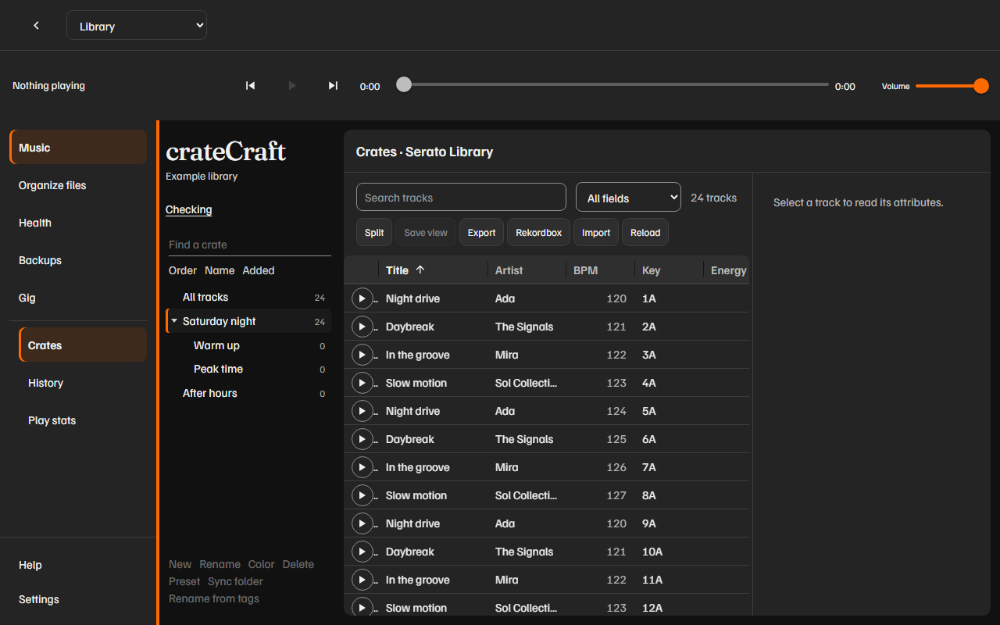

# Crates

Crates are the lists on the left when **Crates** is selected. The first row is **All tracks**. That row is the whole space. It is not a crate you can rename. A crate whose tracks are all on a drive that is not plugged in says **Not connected** and is dimmed. Those tracks are not missing. **New** has **Overwrite a crate with the same name**, and it starts off, so a crate file that already has that name on a drive is left as it is.

The navigation highlights the open section. On a window 980 pixels wide or narrower the rail starts mini; use the menu button to open labels. The crate list, track grid, and details share the window so Title, Artist, and BPM stay readable. A saved list width cannot hide the crate list or the details. Search and the field menu sit above the crate actions. **New**, **Rename**, and **Delete** stay on that row. A chip on that row names the live library and each complete snapshot. **Color**, **Preset**, **Tree**, **Sync folder**, **Local copy**, and the rest sit under **More**. **Split**, **Save view**, and **Export** sit under **More** above the track list. A long crate list scrolls inside the crate pane. Collapsing the navigation drawer leaves crate names in the main column. Scroll sideways inside the track grid to reach more columns; the search controls and track details stay in place.

The picture uses a small sample library. Track details include **Reveal in Finder** on Mac or **Reveal in File Explorer** on Windows.

## Spaces

The space menu in the crate list header chooses a space.

| Menu label | What it is |
| --- | --- |
| Library | The main Serato library |
| Video | Serato Video |
| Apple Music | Apple Music tracks Serato has indexed |
| Prepare | The Prepare list |

Each space has its own crates. Switching space returns you to **All tracks**. The address bar keeps the open view and crate (`#library/crates` for All tracks). Refresh and Back restore that screen.

## Find and sort

1. Select **Crates**.
2. Type in **Find a crate**. Parent crates stay visible when a nested name matches.
3. Choose **Order**, **Name**, or **Added**. **Order** is Serato's own order. **Name** is alphabetical. **Added** is the date the crate was created.

The number on a crate is how many of its tracks are in the current list. The line at the bottom of the rail is the track count, the total time, and the total size for the view you are in. Search does not change that total.

## Move around the list

1. Click a crate to show its tracks.
2. Click the arrow beside a crate to open or close it.

From the keyboard, click the crate list first.

| Key | Action |
| --- | --- |
| Up or Down | Move between crates |
| Home or End | Jump to the first or last crate |
| Right | Open a crate, or move down |
| Left | Close a crate, or move to its parent |
| Enter or Space | Select the crate |

In the track list, Up and Down move the selection. Enter opens the row. The other keys, including find and the view numbers, are in [Keyboard shortcuts](shortcuts.md).

## Tracks

The columns are a checkbox, then **Play**, **Title**, **Artist**, **BPM**, **Key**, **Energy**, **Genre**, **Added**, **Last**, **Plays**, and **Time**. **Play** sits after the checkbox. **Title** is the name. A mark on the title says whether the track is prepped. **Energy** is the star rating as 1 to 5. **Last** is the last time the track was played. Headers stay with the cells when you scroll. Drag a header edge to resize. The column menu can hide a column. A library larger than 100 tracks pages 100 at a time.

1. Type in **Search tracks**. A track matches when the words appear in the title, artist, album, genre, key, or file name. Choose **Comments**, **Grouping**, or **Composer** in the field menu to search that field. Filter words: `bpm:120-128`, `bpm:124~3`, `bpm:none`, `key:8A`, `key:none`, `mix:8A`, `missing:yes`, `nokeybpm:yes`, `cues:none`, `comments:`, `grouping:`, and `composer:`. `missing:yes` is a missing file on a connected drive. `nokeybpm:yes` is a blank key or no BPM. `cues:none` matches a track whose file was read and has no cue points. A track whose cues were not checked does not match. The list load opens local audio headers. An unplugged drive and a cloud placeholder stay unopened. The list checks whether each file opens. It does not decode the audio. It does not download a streaming track or a cloud file.
2. Click a column heading to sort. Click it again to reverse the sort. Numbers start high to low. Words start at A.
3. Click a row to open it on the right. [Track details](tags.md) explains that pane.
4. Check two or more rows to rewrite one text field on those tracks. Choose the field, type the value, click **Review**, then **Apply**. Apply stays off until Review matches, the library is writable, and at least one row would change. Check **Write to files too** to also write ID3 and MP4. Quit Serato first. History has no checkboxes.

A row can show **streaming**, **drive offline**, **file missing**, **no path**, or **unknown**, with a tip on that word. Those words are checked again on each load and are not saved. When that check has no reason, a row can still show **missing** or **offline**. A row can also show **stems**. The title mark reads **Prepped** when the file has cues, Serato has analysed it, and the file is here. **Not prepped** names the missing piece (cues, analysed, or file). **Not checked** means a piece could not be checked. That row is not shown as prepped. Nothing is written. Untitled tracks read **Untitled**.

**Export**, **Import**, and **Reload** sit above the list. [Playlists](playlists.md) covers export and import. **Reload** reads the library again.

## Make a crate

Quit Serato first. [Safety and backups](safety.md) explains the status line. The first save in a session copies the library.

1. Select the crate that should hold the new one. Select **All tracks** when you want it at the top level.
2. Click **New**.
3. Type a name in **New crate name**.
4. Confirm.

**This stick is from another library** sits under the name. It starts off. Leave it clear and a stick that already has crates from another library is left as it was. Check it, then confirm. The app saves a copy of that stick's crates, then writes.

The page says **Crate created.** There is no drag and drop. A new crate is created inside the crate you had selected. This app does not move an existing crate to a new parent.

**New** creates a normal crate. It does not create a smart crate.

## Preset

**Preset** under **More** builds a crate from rules. Quit Serato DJ Pro first.

1. Choose Mixes with a key, BPM range, Not played lately, or Custom rules.
2. Fill the fields. Custom rules can nest one AND/OR group.
3. Preview the match count.
4. Confirm **Create crate**.

When the rules fit what Serato stores, the app writes a live smart crate. Serato updates it on its own. Mixed AND/OR, play history, and a crate limit stay a normal crate whose name ends in ⟳. Refresh shows on those copy crates.

## Rename, color, and delete

Select a crate other than **All tracks**.

| Button | What you do | What happens |
| --- | --- | --- |
| **Rename** | Type the new name in **Rename crate**. | The crate keeps its tracks. |
| **Color** | Type one of `none`, `red`, `orange`, `yellow`, `green`, `blue`, `purple`, `pink`. | The crate color is saved. Any other word shows **Use one of the palette names.** |
| **Delete** | Confirm in the dialog. Nested crates go too. | Those crates are removed. The tracks stay in the library. |

The color names in the track editor are **None**, **Red**, **Orange**, **Yellow**, **Green**, **Blue**, **Purple**, and **Pink**.

## Smart crates

A smart crate shows the word **smart** on its row. Its tracks come from rules, not from checkboxes. **Preset** writes a live smart crate when the rules fit. You can still make one in Serato DJ Pro and edit the rules here.

1. Select the smart crate.
2. Read the **Matches** line. It states the rules in a sentence, joined with **and** or **or**.
3. Edit the JSON in **Smart crate rules** only when you know the change you want.
4. Click **Save rules**.

The page says **Rules saved.** If the text is not JSON, the page says **Smart crate rules need to be JSON.** and nothing is saved.

You cannot tick a smart crate in the track's crate list. The page names those crates and leaves them out of the checkboxes. Putting another crate inside a smart crate is refused. The message is **A smart crate cannot contain another crate.** Adding a track by hand is refused. The message is **Smart crates choose their tracks from rules.**

## Copy smart crates to a drive

**Copy smart crates** on **Check drive** writes each smart crate's rules and its current tracks into that drive's `_Serato_` folder. On another computer, **Restore smart crates** shows a preview. **Restore** writes it. Quit Serato first. A rule that cannot be rebuilt becomes a normal crate named in the preview. An existing smart crate stays until you confirm. **Replace on drive** is the only way an existing file on the drive is replaced.

## Put a track in a crate

1. Open the track.
2. Scroll to **Crates**.
3. Tick a normal crate to add the track. Clear the tick to remove it.

The audio file stays where it is.

## Build a crate tree

**Tree** makes a parent crate with a ⟳ subcrate per BPM band, key, genre, or genre family. Empty subcrates are not made. Quit Serato first. Audio files stay as they are.

1. Click **More**, then **Tree**.
2. Choose **BPM bands**, **Keys**, **Genres**, or **Genre families**.
3. For BPM, set low, high, band width, and step. For genres and genre families, set fewest tracks and the cap. Keys has no extra fields.
4. Optional: tick **Only tracks in** the selected crate and its subcrates when a normal crate is selected.
5. Read the preview. Create tree stays off when no subcrate would be made.
6. Click **Create tree**.

The default name is **BPM bands**, **Keys**, **Genres**, or **Genre families**. The subcrates refresh like any preset crate. [Crate trees](crate-trees.md) covers the dialog.

## Local copy

**Local copy** is under **More**. It makes a crate of the local tracks in the selected crate. Streaming tracks stay in the original crate. The new crate is the crate name plus `local`, under `_crateCraft generated` / `Local copies`. A crate that is already all local, all streaming, or already inside that generated folder is not copied. Quit Serato DJ Pro first. A re-run replaces only that local copy.

## Sync with a folder

Select a normal crate. **All tracks** and a smart crate cannot sync.

1. Click **Sync folder**.
2. Type the folder path on this computer.
3. Optional: tick **Make a subcrate for each subfolder**. Files in the folder stay in this crate. Each subfolder gets a child crate of that name, or reuses one that already exists.
4. Optional: tick **Remove tracks whose files are not in this folder**.
5. Read the preview. Files that are not in the library stay skipped. Nothing is imported.
6. Click **Sync crate**.

The page says the crate was updated, or that it already matches that folder. Quit Serato DJ Pro first.

## Sync with a folder

Select a normal crate. **All tracks** and a smart crate cannot sync.

1. Click **Sync folder**.
2. Type the folder path on this computer.
3. Optional: tick **Make a subcrate for each subfolder**. Files in the folder stay in this crate. Each subfolder gets a child crate of that name, or reuses one that already exists.
4. Optional: tick **Remove tracks whose files are not in this folder**.
5. Read the preview. Files that are not in the library stay skipped. Nothing is imported.
6. Click **Sync crate**.

The page says the crate was updated, or that it already matches that folder. Quit Serato DJ Pro first.
