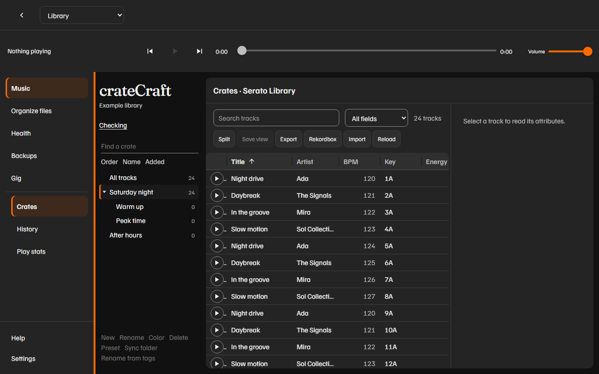

# Crates

Crates are the lists on the left when **Crates** is selected. The first row is **All tracks**. That row is the whole space. It is not a crate you can rename.

The navigation highlights the open section. On a narrow window the rail starts mini; use the menu button to open labels. Search and the field menu sit above the crate actions. Scroll sideways inside the track grid to reach more columns; the search controls and track details stay in place.

The picture uses a small sample library. Track details include **Reveal in Finder** on Mac or **Reveal in File Explorer** on Windows.

## Spaces

The space menu in the crate list header chooses a space.

| Menu label | What it is |
| --- | --- |
| Library | The main Serato library |
| Video | Serato Video |
| Apple Music | Apple Music tracks Serato has indexed |
| Prepare | The Prepare list |

Each space has its own crates. Switching space returns you to **All tracks**.

## Find and sort

1. Select **Crates**.
2. Type in **Find a crate**. Parent crates stay visible when a nested name matches.
3. Choose **Order**, **Name**, or **Added**. **Order** is Serato's own order. **Name** is alphabetical. **Added** is the date the crate was created.

The number on a crate is how many of its tracks are in the current list. The line at the bottom of the rail is the track count, the total time, and the total size for the view you are in. Search does not change that total.

## Move around the list

1. Click a crate to show its tracks.
2. Click the arrow beside a crate to open or close it.

From the keyboard, click the crate list first.

| Key | Action |
| --- | --- |
| Up or Down | Move between crates |
| Home or End | Jump to the first or last crate |
| Right | Open a crate, or move down |
| Left | Close a crate, or move to its parent |
| Enter or Space | Select the crate |

In the track list, Up and Down move the selection. Enter opens the row. The other keys, including find and the view numbers, are in [Keyboard shortcuts](shortcuts.md).

## Tracks

The columns are **Play**, **Title**, **Artist**, **BPM**, **Key**, **Energy**, **Genre**, **Added**, **Last**, **Plays**, and **Time**. **Play** is its own first column. **Title** is the name. **Energy** is the star rating as 1 to 5. **Last** is the last time the track was played. Headers stay with the cells when you scroll. Drag a header edge to resize. The column menu can hide a column. A library larger than 100 tracks pages 100 at a time.

1. Type in **Search tracks**. A track matches when the words appear in the title, artist, album, genre, key, or file name. Choose **Comments**, **Grouping**, or **Composer** in the field menu to search that field. Filter words: `bpm:120-128`, `bpm:124~3`, `bpm:none`, `key:8A`, `key:none`, `mix:8A`, `missing:yes`, `nokeybpm:yes`, `cues:none`, `comments:`, `grouping:`, and `composer:`. `missing:yes` is a missing file on a connected drive. `nokeybpm:yes` is a blank key or no BPM. `cues:none` matches a track the page already knows has no cue points. The list load does not open every audio file.
2. Click a column heading to sort. Click it again to reverse the sort. Numbers start high to low. Words start at A.
3. Click a row to open it on the right. [Track details](tags.md) explains that pane.

A row can show **missing** or **stems**. Untitled tracks read **Untitled**.

**Export**, **Import**, and **Reload** sit above the list. [Playlists](playlists.md) covers export and import. **Reload** reads the library again.

## Make a crate

Quit Serato first. [Safety and backups](safety.md) explains the status line. The first save in a session copies the library.

1. Select the crate that should hold the new one. Select **All tracks** when you want it at the top level.
2. Click **New**.
3. Type a name in **New crate name**.
4. Confirm.

The page says **Crate created.** There is no drag and drop. A new crate is created inside the crate you had selected. This app does not move an existing crate to a new parent.

**New** creates a normal crate. It does not create a smart crate. Make a smart crate in Serato DJ Pro. You can edit its rules here afterward.

## Rename, color, and delete

Select a crate other than **All tracks**.

| Button | What you do | What happens |
| --- | --- | --- |
| **Rename** | Type the new name in **Rename crate**. | The crate keeps its tracks. |
| **Color** | Type one of `none`, `red`, `orange`, `yellow`, `green`, `blue`, `purple`, `pink`. | The crate color is saved. Any other word shows **Use one of the palette names.** |
| **Delete** | Confirm in the dialog. Nested crates go too. | Those crates are removed. The tracks stay in the library. |

The color names in the track editor are **None**, **Red**, **Orange**, **Yellow**, **Green**, **Blue**, **Purple**, and **Pink**.

## Smart crates

A smart crate shows the word **smart** on its row. Its tracks come from rules, not from checkboxes.

1. Select the smart crate.
2. Read the **Matches** line. It states the rules in a sentence, joined with **and** or **or**.
3. Edit the JSON in **Smart crate rules** only when you know the change you want.
4. Click **Save rules**.

The page says **Rules saved.** If the text is not JSON, the page says **Smart crate rules need to be JSON.** and nothing is saved.

You cannot tick a smart crate in the track's crate list. The page names those crates and leaves them out of the checkboxes. Putting another crate inside a smart crate is refused. The message is **A smart crate cannot contain another crate.** Adding a track by hand is refused. The message is **Smart crates choose their tracks from rules.**

## Put a track in a crate

1. Open the track.
2. Scroll to **Crates**.
3. Tick a normal crate to add the track. Clear the tick to remove it.

The audio file stays where it is.

## Sync with a folder

Select a normal crate. **All tracks** and a smart crate cannot sync.

1. Click **Sync folder**.
2. Type the folder path on this computer.
3. Optional: tick **Make a subcrate for each subfolder**. Files in the folder stay in this crate. Each subfolder gets a child crate of that name, or reuses one that already exists.
4. Optional: tick **Remove tracks whose files are not in this folder**.
5. Read the preview. Files that are not in the library stay skipped. Nothing is imported.
6. Click **Sync crate**.

The page says the crate was updated, or that it already matches that folder. Quit Serato DJ Pro first.

## Sync with a folder

Select a normal crate. **All tracks** and a smart crate cannot sync.

1. Click **Sync folder**.
2. Type the folder path on this computer.
3. Optional: tick **Make a subcrate for each subfolder**. Files in the folder stay in this crate. Each subfolder gets a child crate of that name, or reuses one that already exists.
4. Optional: tick **Remove tracks whose files are not in this folder**.
5. Read the preview. Files that are not in the library stay skipped. Nothing is imported.
6. Click **Sync crate**.

The page says the crate was updated, or that it already matches that folder. Quit Serato DJ Pro first.
