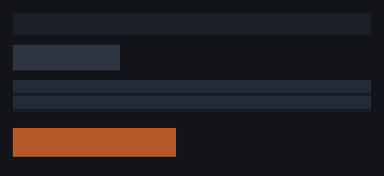
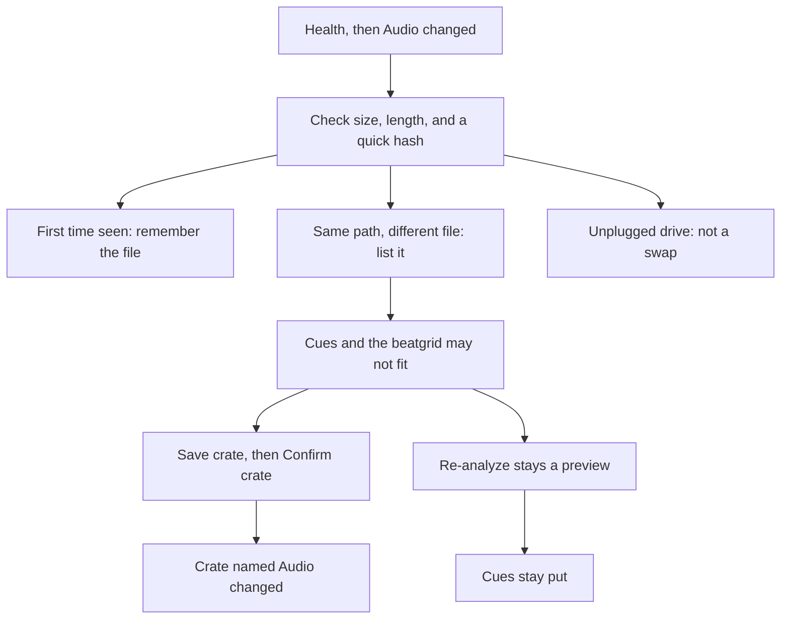

# Audio changed

<figure>
  
  <figcaption>Example data. Paths that start with /tmp/slm-example are example paths. The row is a file replaced under the same name.</figcaption>
</figure>

**Audio changed** is under **Health**. It notices a file replaced under the same name. The first check remembers each file and does not list it. A later change in size, length, or a quick hash is listed. An unplugged drive is not a swap.

The note says cues and the beatgrid may not fit this audio.

**Save crate** shows the plan. Nothing is written until **Confirm crate**. Quit Serato first. The crate is named **Audio changed**.

**Re-analyze** is a preview. Cues stay put. crateCraft does not rewrite cues or the beatgrid to fit the new audio.

**Check again** reloads the list.

On **Backups**, **Music files** copies a same-name file again when the size or hash does not match. [Backups and restore](Backups-and-Restore).
