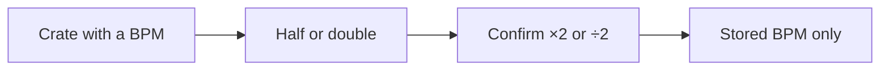

# BPM check

**BPM check** is under **Gig**. Pick a crate. The list flags a stored BPM that is about half or double the rest of that crate. **×2** or **÷2** writes only that BPM after you confirm. The beatgrid is left alone.

Example data. A Friday crate sits near 128 BPM. One track is stored at 64. **×2** offers 128. Confirm writes 128 on that row. The beatgrid on the file stays as it was.

Quit Serato DJ Pro before you save. You can read the list while Serato is open. **All tracks** stays off. A crate with fewer than three usable BPMs is not judged. A crate split evenly between two tempos is not flagged. The list is the review. This check does not make a crate.

If the new BPM does not stay in the library, crateCraft puts the library back. This save is not on the Gig Lock list. The undo is the snapshot taken just before the write.
