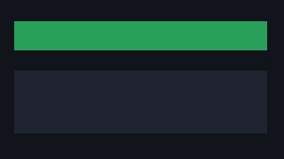
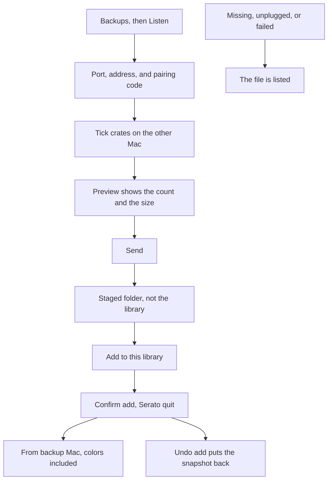

# Backup Mac

<figure>
  
  <figcaption>Example data. Peak time is selected. Preview shows 12 files before Send.</figcaption>
</figure>

**Backup Mac** is on **Backups**. It sends selected crates and their music to another computer running crateCraft on this network. The copy stays in a staged folder. The two libraries are not kept in sync.

**Listen** on the receiving computer shows a port, an address, and a pairing code. **Stop listening** closes that port. A copy that already arrived stays.

The pairing code expires after 15 minutes and changes after a copy arrives. Five wrong tries lock that computer out until you listen again. crateCraft listens on one local address. The copy is not encrypted, so use a network you trust.

On the sending computer, tick the crates, then **Preview**. The page shows the file count and the size. A missing file, a file on a drive that is not connected, and a shortcut are listed. Nothing is sent until **Send**. A wrong pairing code is refused. An address that is not on the local network is refused.

On the receiving computer, **Add to this library** shows the plan. **Confirm add** writes the crates and their colors while Serato is quit. The folder is **From backup Mac** inside **_crateCraft generated**. A track is added only when that library already has the same file. The others stay in the staged folder and are named. **Undo add** puts that snapshot back.

**Remove staged copy**, then **Confirm remove**, deletes the staged folder. Crates already added stay until you undo.
