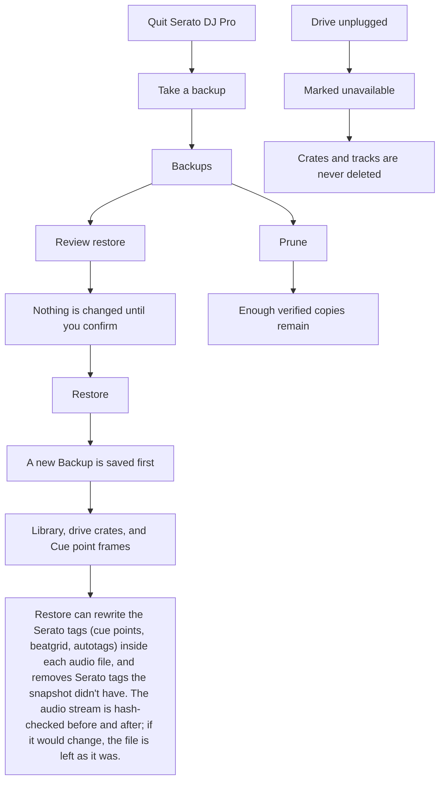

# Backups and restore

Backups in the sidebar are the snapshots you restore. That flow is in the app.

**Backups** keeps each drive's crates. The first save in a session also copies those `_Serato_` folders into `Library/Backups/serato-web-…/drives`. An unplugged drive is listed and skipped.

<figure>
  
  <figcaption>Example data. Review restore is open. The outside-change banner that setup left above the list was cropped off.</figcaption>
</figure>

The first time a newer crateCraft opens your library, it saves a snapshot before it changes anything, and only while Serato DJ Pro is closed. That snapshot is named `before update to vX`. If Serato is still open, that snapshot is not saved and edits stay off until you quit Serato and open crateCraft again. If the copy cannot be saved, edits stay off. To go back one version, install the previous disk image or the previous Windows installer, quit Serato DJ Pro, and restore that snapshot. The newer copy stays on disk until the older app is open. Opening crateCraft does not delete the other copy.

Open **Backups**. **Take a backup** sits above a table of snapshots with **When**, **Size**, and **Status**. **Take a backup** saves a hash-checked Backup of the library database, the crates on each drive (the `_Serato_` folder and `database V2`), and the Cue point, beatgrid, and autotag frames inside the audio files. The music itself is not copied. **Prune** on a row moves that backup into **Removed items** for 7 days after a confirm, only when enough verified copies remain (the live library plus other complete snapshots). Unplugged or untrusted drives, and a snapshot whose hash check failed, do not count. **Restore** puts it back. **Cancel removal** keeps it. **Remove permanently** waits until the window ends, and never removes a file another DJ app still uses. Settings **Verified copies before delete** is how many must remain (2 unless you change it). A chip on Crates names the live library and each complete snapshot.

**Backup Mac** on the same page sends selected crates and their music to another computer running crateCraft on this network. **Preview** shows the file count and the size. **Send** copies them into a staged folder on that computer. Nothing is mirrored on its own. On the other computer, **Add to this library** shows the plan. **Confirm add** writes the crates and their colors while Serato is quit, and **Undo add** puts that snapshot back. A file that fails or is skipped is listed. Tracks the other library does not already have stay in the staged folder.

**Music files** on the same page copies library audio to a second drive or NAS. Type the backup folder, then **Preview**. **Copy** writes the files that are missing or whose size or hash differs. A same-name file is copied again when the size or hash does not match. Cue points stay in the audio because the copy is byte-for-byte. **Restore to this computer** copies dest files back and skips a laptop file that is newer. **Make crate** saves tracks that exist only on this laptop. **Relink missing** points missing rows at dest files. Dest cannot be the Serato folder, the Serato library, or a music folder.

To back up an already-prepared gig stick (music plus `_Serato_`) without writing that stick, use **Back up this stick** under **Gig → Check drive**. That is a different job from **Music files**.

**Protect BPM**, **Protect key**, and **Protect cues** in Settings keep those values when a save or a duplicate merge would change them. **Gig Lock** in Settings queues crate and track edits while you gig. The list sits on Backups. **Preview**, then **Apply**, after Serato is closed and Gig Lock is off. If Serato also changed that crate, both copies stay: the live crate as Serato left it, and a sibling named from crateCraft with the day and time. Each applied change can be undone for 30 days.

**Batch** on Backups queues tracks and crates from more than one view. Preview shows the first item and writes nothing. Apply adds them to one crate under one snapshot. Undo puts that whole batch back. Quit Serato first.

**Review restore** on a row shows crates, tracks in a crate, deleted crates, Cue changes, and grid changes. When this snapshot came from a crateCraft write, **What changed** names the files that write touched. It also lists crate files the library has not heard of. Serato 4 and 5 delete those files the next time Serato opens, so restore writes them into the library as well as putting the files back. If the library has no Serato Library space, those files are put back but not registered, and the plan says Serato may remove them on the next launch. The rest of the restore still finishes. **Nothing is changed until you confirm.** **Restore** saves a new snapshot first, so the list can undo it. While it runs, Restore shows a spinner and progress, and **Cancel** stops it before the files are replaced. A toast names success, skipped crate files, a failure, or a cancel, with **Undo** and **View details**. The AppBar tray lists that write on every page. If the app stops in the middle, the next open puts that saved snapshot back.

Restore can rewrite the Serato tags (cue points, beatgrid, autotags) inside each audio file, and removes Serato tags the snapshot didn't have. The audio stream is hash-checked before and after; if it would change, the file is left as it was.

Health, Gig, and other read-only checks copy the library first, so they do not change the Serato folder and do not trip the outside-change notice.

An unplugged drive is marked unavailable, never deleted. Its crates and tracks stay in the Backup, and a restore does not remove them. The plan lines are **Crates on an unavailable drive** and **Tracks on an unavailable drive**.

Quit Serato DJ Pro before you restore. If Serato is still running, restore stops. On Serato 5.0 and Serato 5.1.0, writes and restores run when Protect Library is off. A Serato 5.1.0 library whose schema does not match the checked version stays read-only. If Protect Library is on or cannot be read, the note names the version and that preference. Lucid beatgrid storage is not parsed. Snapshots can still be taken and read. The newest session log in `_Serato_/Logs` can name Serato 4 or Serato 5. A log that does not name a dotted version is unknown. If the installed version cannot be read, that log does not turn writes back on. An unreadable version does the same: writes and restores stay off until a version can be read.

If something else changes the Serato folder, including Lexicon, the app saves a snapshot after that change and offers **Review undo**. That puts back the previous snapshot. The app does not read or restore `_Serato_/Lexicon/` or `_Serato_/Export Backups/`. A crate or track save also stops when the library files changed on disk after they were loaded. The page asks **Write anyway?** Confirm retries the same save. Cancel leaves the library as it is.

The first save in a session also copies `master.sqlite`, `root.sqlite`, and each connected drive's `_Serato_` folder into `Library/Backups/serato-web-` plus the date and time. Each drive's files stay in their own `drives` directory. An unplugged drive is listed and not copied. A drive whose folder cannot be read is listed and not copied, and the other drives are still saved. The folder does not hold your music. `Recording` and `DJ Sessions` are not copied. If the disk does not have room, the copy is refused. The hash-checked Backups live in `Library/Backups/snapshots`, beside `master.sqlite`. **Back up drive crates**, on Backups, copies connected drives without changing the library.

After a save, the app reads a copy of the database back. If the rows or file hashes do not match, it puts the pre-write copy back. That copy is kept in the app's data folder, not in Serato's library folder. Serato 5 uses that same rollback when Protect Library is off. After a restore writes the files, it checks their hashes. A mismatch puts the snapshot from before the restore back. **Backups** lists each edit and each restore. A change that could not be put back stays in that list and is not shown as finished. A snackbar that names a file (for example `master.sqlite`) and points at this list, or at the local log in Settings, is that same failure. The full path stays in the local log.

On a Mac, external drives need **Files and Folders > Removable Volumes**. The steps are on [Install on a Mac](Install-macOS).
