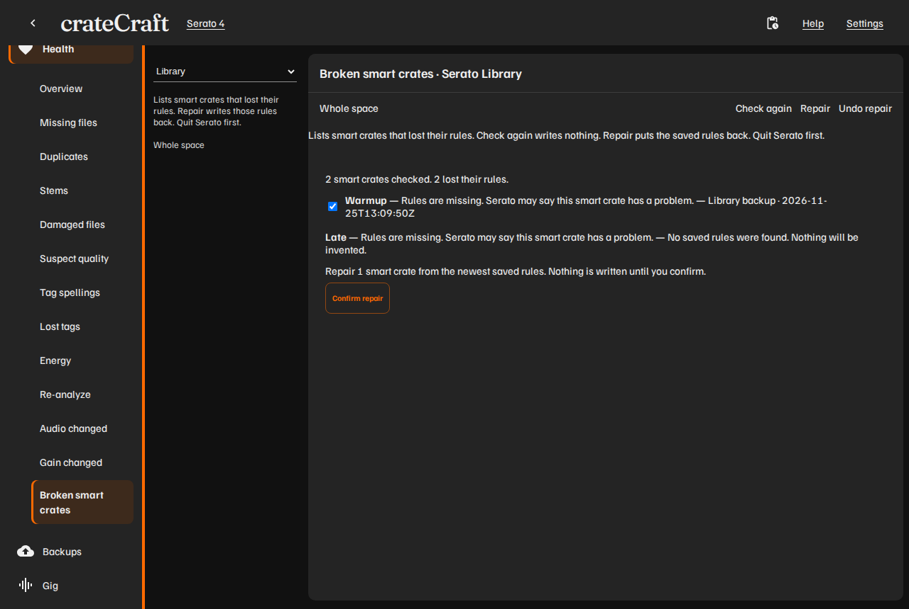
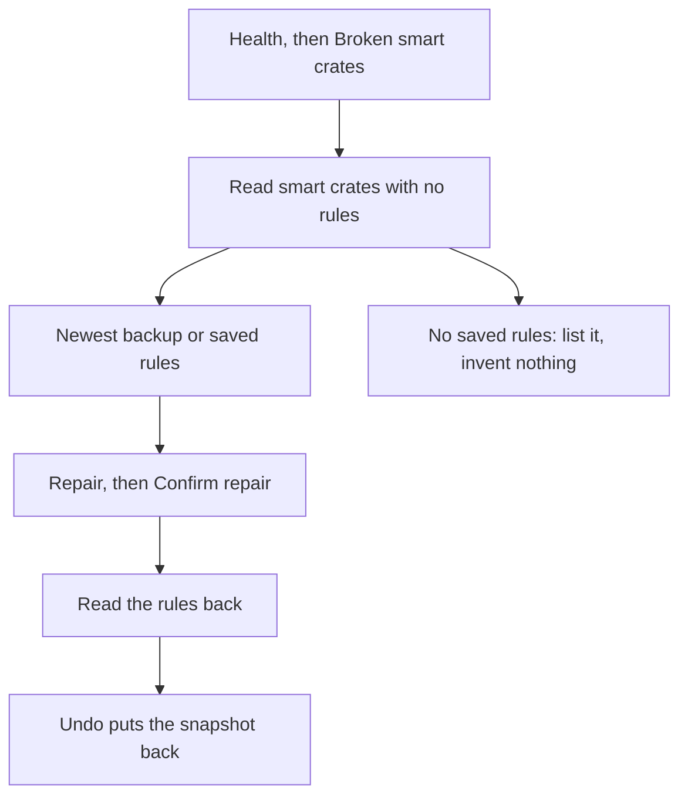

# Broken smart crates

<figure>
  
  <figcaption>Example data. Warmup can be repaired. Late has no saved rules, so it stays listed and is left alone.</figcaption>
</figure>

**Broken smart crates** is under **Health**. It lists smart crates that lost their rules. Checking the list writes nothing.

**Repair** shows the plan for the crates you checked. Nothing is written until **Confirm repair**. Quit Serato first. The rules come from the newest backup, snapshot, sandbox copy, or drive database that still has them, or from a saved smart-crate file when no database copy does. A crate with no saved rules is left as it is.

crateCraft reads the rules back. If they are still missing, the snapshot is put back and the page says so.

**Undo repair** puts that snapshot back.

**Check again** reloads the list. Use it after another program syncs the library. That check does not write.
