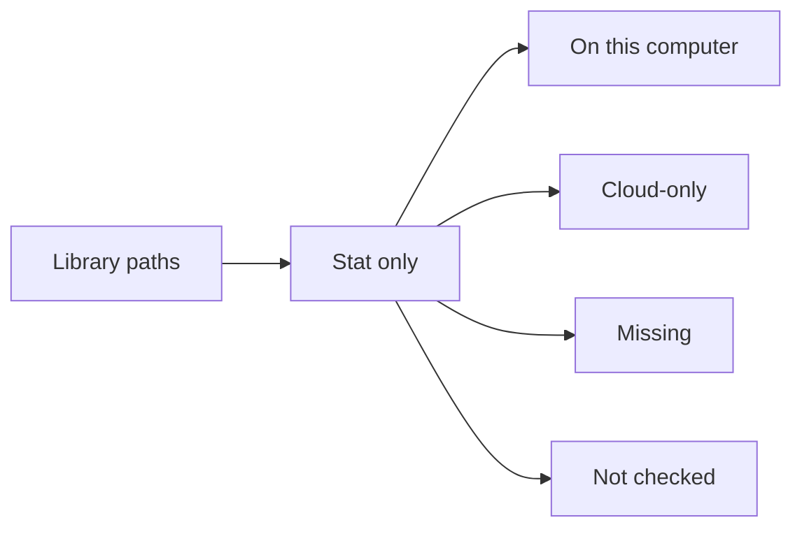

# Cloud-only

**Cloud-only** is under **Gig**. It lists tracks whose audio is not fully on this computer, so you can download them before a gig. The check does not download them and does not change the library.

Example data. Friday has four tracks on this computer, one dataless iCloud file, one file in a cloud folder this check does not fully know, and one missing file. The missing file stays under Missing files. The unknown file is not counted as on this computer. The dataless file is **Not ready** until you download it in Finder.

**Ready** shows the same cloud-only paths on their own step, separate from missing files. An unplugged drive is named there too, and is not a missing file. Quit nothing to read the list. Downloading happens in Finder or File Explorer, not in this screen.
