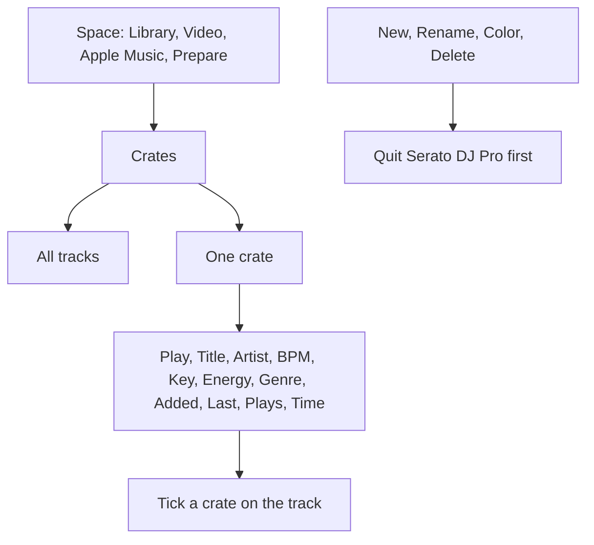

# Crates

The navigation highlights the open section. On a narrow window the rail starts mini; use the menu button to open labels. The crate list header holds the space menu. Search and the field menu sit above the crate actions. Scroll sideways inside the track grid to reach more columns; the search controls and track details stay in place.

<figure>
  
  <figcaption>Example data. Deep House is open, and the track's crate checkboxes are on the right. The space menu is drawn here as an expanded list. In the app it is the native dropdown.</figcaption>
</figure>

The track list puts **Play** in its own first column. **Title** is the name. Headers stay over the cells when you scroll. Drag a header edge to resize. The column menu can hide a column. A library larger than 100 tracks pages 100 at a time.

**Crates** is the list on the left. The first row is **All tracks**. That row is the whole space. It is not a crate you can rename.

The space menu shows **Library**, **Video**, **Apple Music**, and **Prepare**. Each space has its own crates. Switching space returns you to **All tracks**. The address bar keeps the open view and crate (`#library/crates` for All tracks). Refresh and Back restore that screen.

**Find a crate** keeps a parent visible when a nested name matches. **Order** is Serato's own order. **Name** is alphabetical. **Added** is the date the crate was created.

Quit Serato DJ Pro before **New**, **Rename**, **Color**, or **Delete**. When Serato is open, a notice under the top bar says edits stay off.

| Button | What you do |
| --- | --- |
| **New** | Type **New crate name**. The crate is created inside the one you had selected. **All tracks** puts it at the top. |
| **Rename** | Type **Rename crate**. The tracks stay. |
| **Color** | Type one of `none`, `red`, `orange`, `yellow`, `green`, `blue`, `purple`, `pink`. |
| **Delete** | Confirm in the dialog. Nested crates go too. The tracks stay in the library. |
| **Sync folder** | Type a folder path. Preview, then confirm. Library tracks whose files sit in that folder are added. Files that are not in the library stay skipped. Optional subcrates map each subfolder to a child crate. Optional full remove takes out members whose files left that crate's folder. |

There is no drag and drop. This app does not move an existing crate to a new parent. **New** does not make a smart crate. Make that in Serato, then edit the rules here.

A smart crate shows **smart**. You cannot tick it in the track's crate list. Putting a crate inside it says **A smart crate cannot contain another crate.** Adding a track by hand says **Smart crates choose their tracks from rules.**

To put a song in a crate, open the track, find **Crates**, and tick a normal crate. The audio file stays where it is. Moving, renaming, or trashing the file is [Organizing files](Organizing-Files).

**Use in crates** puts another track in every normal crate this one is in, at the same position. Both tracks can stay, or you can then take this one out of those crates. Smart crates and the space list stay as they are. The audio files stay. Merge copies is the tool that folds duplicates into one library row.
