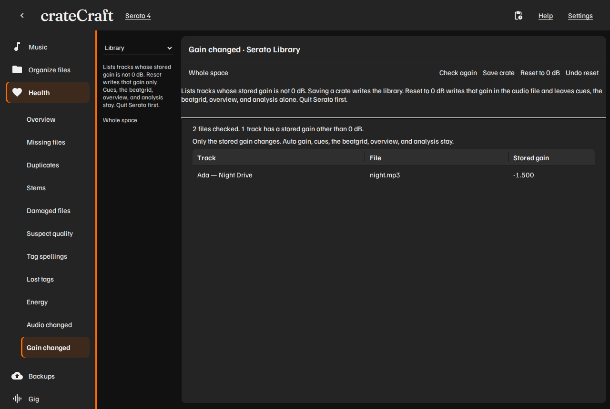
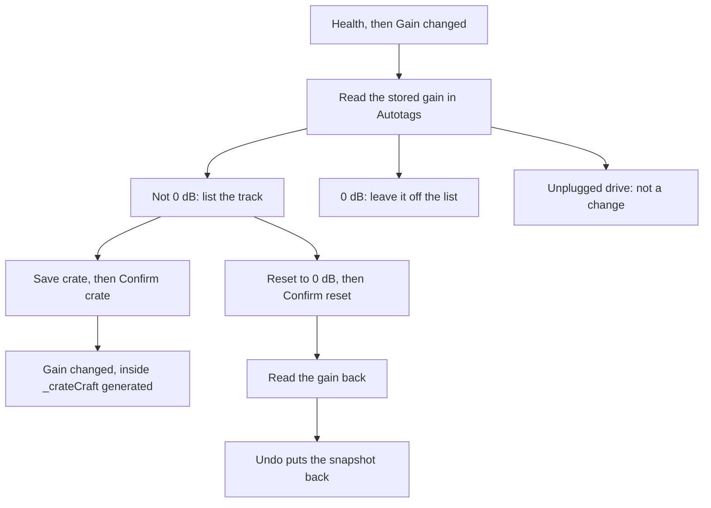

# Gain changed

<figure>
  
  <figcaption>Example data. The row is a track whose stored gain is not 0 dB.</figcaption>
</figure>

**Gain changed** is under **Health**. It lists tracks whose stored gain is not 0 dB. Checking the list writes nothing.

**Save crate** shows the plan. Nothing is written until **Confirm crate**. Quit Serato first. The crate is named **Gain changed** and sits inside **_crateCraft generated**. A crate you named Gain changed somewhere else is left as it was.

**Reset to 0 dB** shows the plan. Nothing is written until **Confirm reset**. Quit Serato first. Only that stored gain changes. Auto gain, cues, the beatgrid, the overview, and the analysis stay. crateCraft reads the gain back. If it is not 0 dB, the snapshot is put back and the page says so.

**Undo reset** puts that snapshot back.

**Check again** reloads the list.
