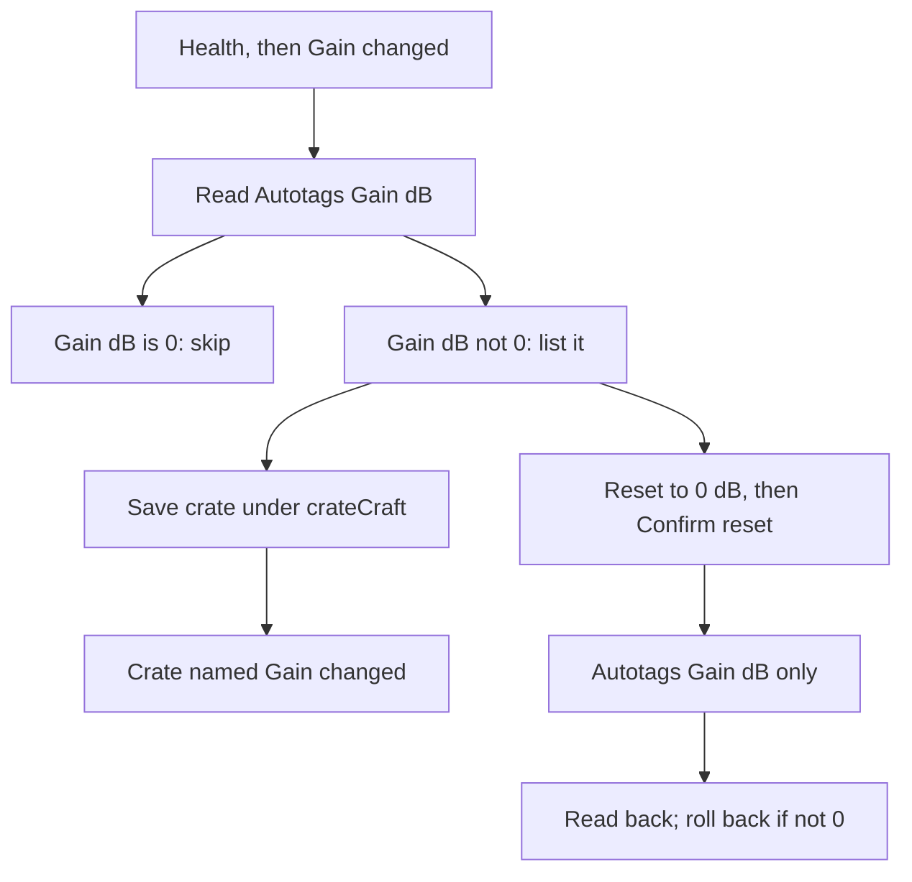

# Gain changed

<figure>
  
  <figcaption>Example data. Paths that start with /tmp/slm-example are example paths. The row is a track whose stored Gain dB is not 0.</figcaption>
</figure>

**Gain changed** is under **Health**. It lists tracks whose Serato Autotags Gain dB is not 0. Auto Gain stays as it was. Markers2, BeatGrid, and Overview stay as they were.

The note says reset writes only that Gain dB field. Quit Serato first.

**Save crate** shows the plan. Nothing is written until **Confirm crate**. The crate is named **Gain changed** under a labelled **crateCraft** folder, so a crate you made is not overwritten.

**Reset to 0 dB** shows the plan. Nothing is written until **Confirm reset**. Quit Serato first. A snapshot is taken first. After each write, crateCraft reads the Autotags again; if Gain dB is not 0, the library is put back. Undo from **Backups**.

**Check again** reloads the list.
