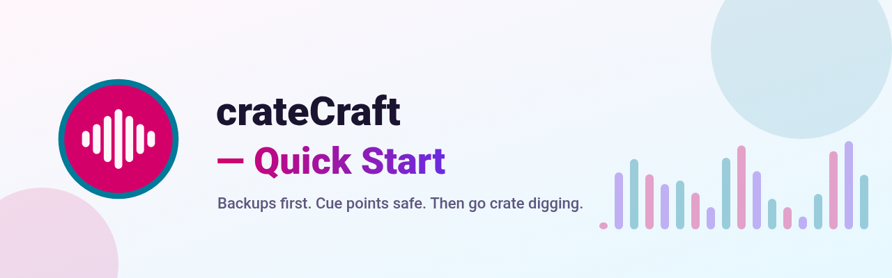
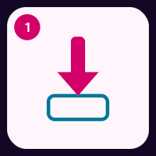

# Serato Library

<!-- The logo on the banner is not approved yet. It may change. -->

**Five moves.** Backups first. Cue points safe. Then go crate digging.

Start here: **[Quick Start](Quick-Start)**. One page. Five steps.

1. 📥 Download
2. 💿 Install (Mac and Windows)
3. ▶️ Open
4. 🛡️ First backup
5. 🎧 Find your music

A window on your computer for the Serato DJ Pro library. Crates, Cue points, and Backups stay on this machine.

- [Install on a Mac](Install-macOS)
- [Install on Windows](Install-Windows)

The long guide is published at <https://mookiejones.github.io/serato-library-manager/>.

## What you click

**Library** sits at the top of the sidebar. The status line under it starts as **Checking Serato**.

The rail groups are **Library** (Crates, History, Files), **Library health** (Missing files, Duplicates, Stems, Damaged files, Tag spellings), **Backups**, and **Before a gig**.

Double-click a track to play it. The bar under the list has pause, seek, and volume. Playback does not change the file.

The space menu shows **Library**, **Video**, **Apple Music**, and **Prepare**.

**Settings** is at the bottom of that sidebar. It lists the keys under **Keyboard shortcuts**. **?** opens that list. Ctrl+K or Command+K finds a track or a file. Hover a control, or tab to it, to read what it does. If it has a shortcut, the note shows that key.

## Cue points and Backups

Cue points live in the audio file. A normal save does not rewrite them.

**Backups** keeps hash-checked copies of the library, the crates on each drive, and the Cue point frames stored in the audio files. The music itself is not copied.

Open **Backups**, choose **Review restore**, then **Restore**. Restore can rewrite the Serato tags (cue points, beatgrid, autotags) inside each audio file, and removes Serato tags the snapshot didn't have. The audio stream is hash-checked before and after; if it would change, the file is left as it was.

Quit Serato DJ Pro before a write. On Serato 5, writes and restores stay off.

## One download

GitHub Releases is the only download. There is no Homebrew formula, no winget package, and no other website.

**Rekordbox** can export `rekordbox.xml`. The guide marks that export **PREVIEW**.
