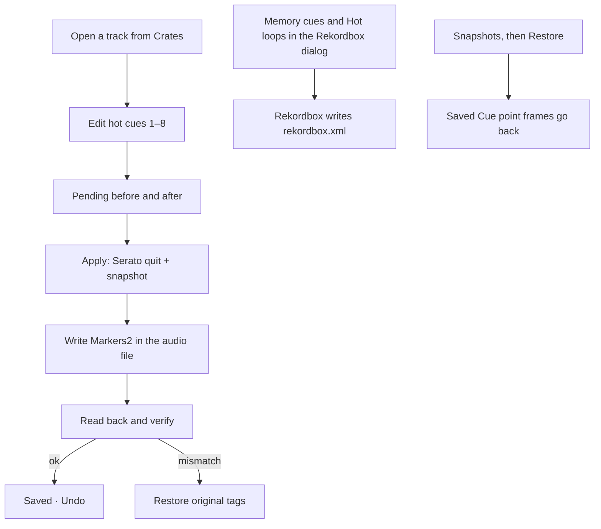

# Hot loops and Cue points

<figure>
  
  <figcaption>Example data. Memory cues is on, Hot loops is off, and the open track lists Cue points and a loop.</figcaption>
</figure>

Cue points, loops, and the beatgrid live in the audio file. Open a track from **Crates**. Chips under the title jump to each section. The section is **Cue points**. For a file this app can edit, the line under it explains that hot cues 1–8 can be changed here, Apply writes the audio file after a snapshot, and you should quit Serato first. Saved loops and the beatgrid stay view-only.

On pads 1–8 you can **rename**, **recolor** (Serato pad colors), **move** (±1 ms, ±10 ms, ±1 beat, or type a time), **delete**, **set at the playhead** on an empty pad, and **swap** two pads. Changes stay pending until **Apply**, which shows before and after for each changed pad. Apply is blocked while Serato is running. After a successful write, **Undo** puts the previous tag bytes back. If the read-back does not match, the original tags are restored and nothing is left half-written.

Pads show in Serato's pad colors. A cue that already has a color keeps it. An unused pad among those still shows its number and color, and reads **Empty** until you set it. A track with no cues, loops, or beatgrid says **No cue points**. A beatgrid still shows when there are no cues. **Beatgrid** says **View only. This app does not rewrite the beatgrid.** A grid this parser cannot read is flagged **Suspect beatgrid** with the reason. **Hide** keeps that card closed on the next track.

**Save track** writes the library fields. Cue Apply writes the Markers2 tag in the audio file (MP3, AIFF, M4A, FLAC). A missing file says **The file is not on disk, so cues cannot be read.** and does not invent pads. An unsupported or protected file shows why editing is off, and the controls stay disabled.

**Check drive** can copy a cue that exists only on a stick into an empty pad. **Review stick cues** lists those cues and writes nothing. **Import empty pads** copies them into empty pads. A pad that already has a cue stays.

**Hot loops** sits beside **Memory cues** in the Rekordbox dialog. **Memory cues** starts on. **Hot loops** starts off. The help line reads **Uses a free hot-cue pad.** The app remembers Memory cues, Hot loops, and the key notation (**Key as stored**, **Camelot key**, or **Classical key**) in `settings.json`.

Those boxes change the Rekordbox file only. They do not move pads inside Serato. With **Hot loops** on, a saved loop takes its own pad when that pad is free and it is one of the first eight. A loop whose pad is already taken stays a memory loop. A loop past those eight pads stays a memory loop too. With the box clear, every saved loop stays a memory loop.

Putting Cue points back is a restore from **Backups**. **Review restore** lists each file whose cues would change, and for a pad that would change it shows the time and name before and after. Restore can rewrite the Serato tags (cue points, beatgrid, autotags) inside each audio file, and removes Serato tags the snapshot didn't have. The audio stream is hash-checked before and after; if it would change, the file is left as it was. [Backups and restore](Backups-and-Restore) is that flow. The export keeps **Status: preview** on [Export to Rekordbox](Export-to-Rekordbox).
