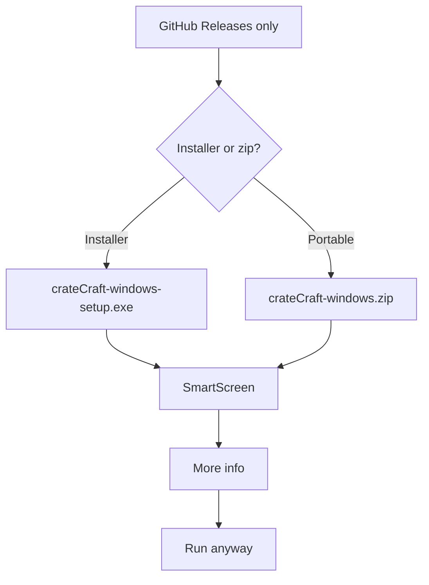

# Install on Windows

GitHub Releases is the only download. The builds are unsigned. SmartScreen warns once. The warning is expected.

## Pick the file

| You want | File |
| --- | --- |
| An installer | `crateCraft-windows-setup.exe` |
| A folder you can move | `crateCraft-windows.zip` |

`SHA256SUMS` is on that same release.

The pre-release **v1.1.0-rc2** attaches both files under their pre-rename `Serato-Library-` names. The release marked Latest is **v0.1.1**. v0.1.1 attaches `Serato-Library-windows.zip` only.

## Installer

1. Download `crateCraft-windows-setup.exe` from [GitHub Releases](https://github.com/mookiejones/crateCraft/releases).
2. Open the installer.
3. When SmartScreen appears, choose **More info**.
4. Choose **Run anyway**.
5. Leave **Open crateCraft** checked at the end.

## Portable zip

1. Download `crateCraft-windows.zip`.
2. Unzip it and leave the folder where it is.
3. Open `crateCraft.exe` inside that folder. Do not run it from inside the zip.
4. When SmartScreen appears, choose **More info**.
5. Choose **Run anyway**.

## You are in

The window uses the installed WebView2 runtime. The title is **crateCraft**. Close the window to quit. A second open focuses that window.

The page is served on `127.0.0.1`. Next: [Quick Start](Quick-Start).
