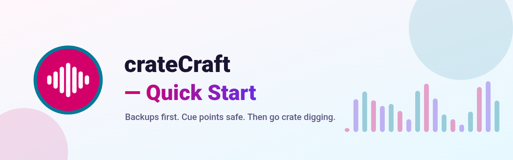
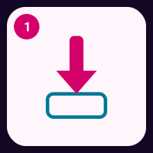
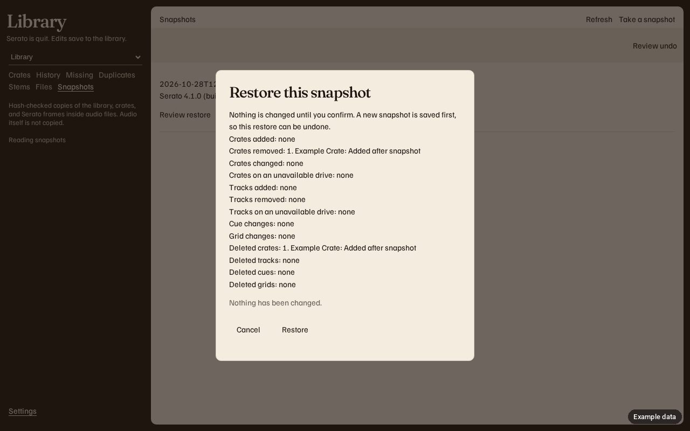
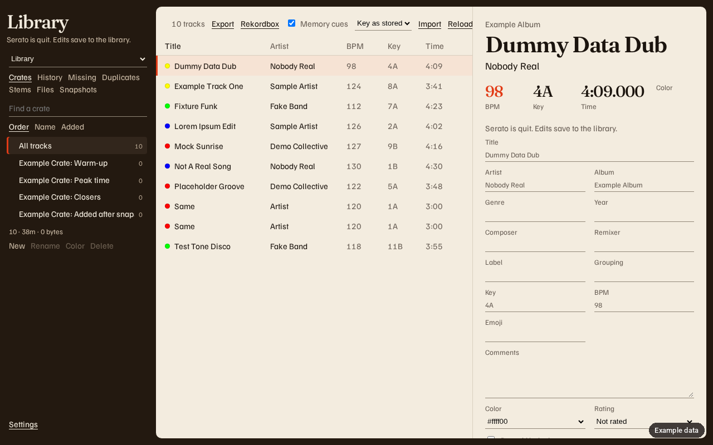
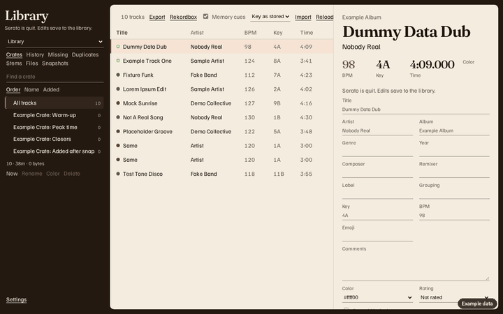

# Quick Start

<!-- The logo on the banner is not approved yet. It may change. -->

Five moves. Backups first. Cue points safe. Then go crate digging.

GitHub Releases is the only download.

## 1 Download

<figure>
  
  <figcaption>1 Download</figcaption>
</figure>

Grab the build for your machine from [GitHub Releases](https://github.com/mookiejones/crateCraft/releases). No store, no Homebrew, and no winget.

| Your deck | File |
| --- | --- |
| Mac, Apple silicon (arm64) | `crateCraft-macos-arm64.dmg` |
| Mac, Intel (x64) | `crateCraft-macos-x64.dmg` |
| Windows installer | `crateCraft-windows-setup.exe` |
| Windows, no installer | `crateCraft-windows.zip` |

`SHA256SUMS` sits on that same release.

The release marked Latest is **v0.1.1**. It attaches `Serato-Library-macos.zip` (Apple silicon) and `Serato-Library-windows.zip`. The pre-release **v1.1.0-rc2** has the disk images, the installer, the portable zip, and `SHA256SUMS`, named `Serato-Library-…` from before the rename.

## 2 Install (Mac and Windows)

<figure>
  
  <figcaption>2 Install (Mac and Windows)</figcaption>
</figure>

The builds are unsigned, so the computer complains once. The warning is expected.

On macOS 14 and earlier, right-click the app and choose **Open**.

On macOS 15 and later, open the app once. Then go to **System Settings > Privacy & Security > Open Anyway**.

On Windows, SmartScreen says it protected your PC. Choose **More info**, then **Run anyway**.

Mac warnings, including Removable Volumes, are on [Install on a Mac](Install-macOS). Windows warnings are on [Install on Windows](Install-Windows).

## 3 Open

<figure>
  
  <figcaption>3 Open</figcaption>
</figure>

A window titled **crateCraft** opens. It stays on this computer. Close the window to quit.

Choose **Get started**. When the page names your library, choose **Use this library**.

Nothing there yet? Open Serato DJ once, quit it, and choose **Check again**. If the library is already in another folder, choose **Choose a folder**.

**Cancel** leaves the library alone. Setup comes back until you choose **Open my library**.

**Get started**, **Use this library**, and **Take a safety snapshot** are in the app on `main`. They are not in the v0.1.1 download or the v1.1.0-rc2 pre-release.

## 4 First backup

<figure>
  
  <figcaption>4 First backup</figcaption>
</figure>

<figure>
  
  <figcaption>Backups. Example data.</figcaption>
</figure>

Quit Serato DJ Pro if it is open. Choose **Take a safety snapshot**. This copy is your first Backup.

Cue points live in the audio file. The snapshot keeps those frames with the library and the crates on each drive.

If Serato is still open, the page says **Close Serato DJ to continue**.

**No, don't share** leaves anonymous stats off. **Yes, share** is the other choice. Then choose **Open my library**.

Later, open **Backups**. **Review restore** shows the plan before anything is written. Restore can rewrite the Serato tags (cue points, beatgrid, autotags) inside each audio file, and removes Serato tags the snapshot didn't have. The audio stream is hash-checked before and after; if it would change, the file is left as it was.

## 5 Find your music

<figure>
  
  <figcaption>5 Find your music</figcaption>
</figure>

<figure>
  
  <figcaption>Crates. Example data.</figcaption>
</figure>

You land in **Crates**. Time to find your music. The space menu reads **Library**, **Video**, **Apple Music**, or **Prepare**.

Use **Search tracks**, then click a tune. The field menu next to search can limit that box to Comments, Grouping, Composer, title, artist, album, genre, or file. To narrow the crate you have open, type a filter in the search: `bpm:120-128` (a range), `bpm:124~3` (124 give or take 3), `bpm:none`, `key:8A`, `key:none`, `mix:8A` (keys that mix with 8A), `missing:yes`, `nokeybpm:yes` (no key or no BPM), `cues:none`, `comments:`, `grouping:`, or `composer:`. Filters and words combine. **Split** shows a second crate list beside the first. Alt-click or Shift-click a crate to fill the other pane. **Save view** makes a crate from the tracks in the focused list. Serato DJ Pro must be quit for that write. Cue points show on the right. They are read from the audio file. Press `/` to jump to that search. Press Ctrl+K (Command+K on a Mac) to find a track or a file on disk. [Keyboard shortcuts](Keyboard-Shortcuts) lists the other keys.

The rail has five primaries: **Library**, **Organize files**, **Library health**, **Backups**, and **Before a gig**. Tabs for the open parent sit above the main sheet. **Library** is Crates, History, and Play stats. **Library health** is Library health, Missing files, Duplicates, Stems, Damaged files, Suspect quality, and Tag spellings. **Before a gig** is Before a gig, Check drive, and Tempo drift. Organize files and Backups have no extra tabs.

**Hot loops** sits beside **Memory cues** in the Rekordbox dialog. It starts off, and it uses a free hot-cue pad.
