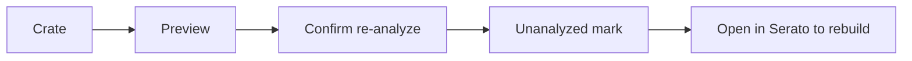

# Re-analyze

**Re-analyze** is under **Health**. Pick a crate. The list shows tracks that still look analyzed. **Preview** shows what will change. **Confirm re-analyze** marks them unanalyzed so Serato rebuilds grids and overviews. Cue points stay.

Example data. A Friday crate has three analyzed tracks. Preview lists them. Confirm clears the analyzed mark and, by default, BeatGrid and Autotags on those files. Markers2 cues stay. Open the tracks in Serato to rebuild.

Quit Serato DJ Pro before you confirm. You can read the list while Serato is open. **All tracks** stays off. **Also clear BeatGrid and Autotags** starts on; turn it off to mark the database only. **Include locked beatgrids** unlocks those rows so Serato can rebuild them. Locked rows are left as they are when that option is off, and the other tracks are still marked. Changing an option turns Confirm off until you preview again. A connected drive gets the same mark. If that copy does not take the mark, the library is put back.

crateCraft does not re-analyze the audio. The undo is the snapshot taken just before the write.
