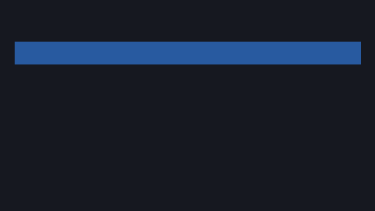
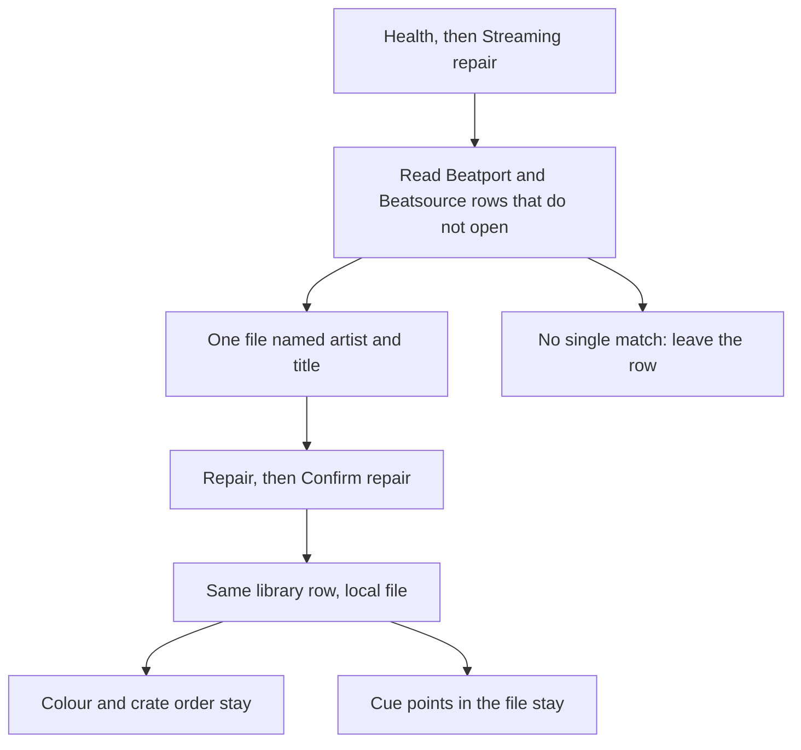

# Streaming repair

<figure>
  
  <figcaption>Example data. The row is a greyed-out Beatport track with one local match.</figcaption>
</figure>

**Streaming repair** is under **Health**. It lists Beatport and Beatsource tracks whose stored identity names that service and whose file does not open. Checking the list writes nothing.

**Repair** shows the plan for each track with one artist-and-title match. Nothing is written until **Confirm repair**. Quit Serato first. The same library row is pointed at the local file. Its colour and its place in each crate stay. Cue points already in the local file are left as they are.

A track whose title only says Beatport, or whose only marker is a source number this app has not recorded, stays off the list. Several files with the same name are shown and are not repaired together.

**Check again** reloads the list.
