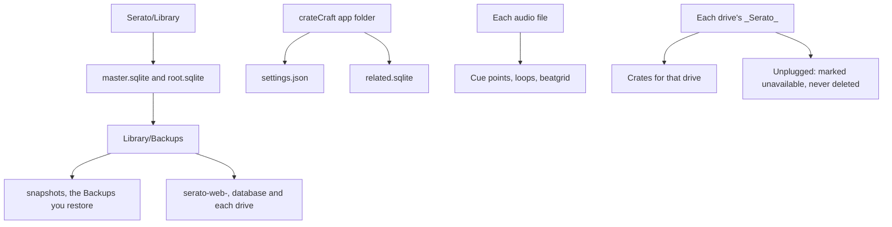

# Where Serato data lives

<figure>
  
  <figcaption>Example data. This is a diagram, not a screenshot. The paths in it are examples.</figcaption>
</figure>

Serato DJ Pro keeps the library in `master.sqlite` on Serato 4 and Serato 5. `root.sqlite` often sits beside it. This app reads both and updates `root.sqlite` when that file is there. Serato 3 kept the library in `database V2` instead. Serato 4 and 5 still write that file when they quit. The paths are listed in `docs/serato-5-macos.md`. `python3 serato_probe.py` reports which of those paths exist and does not open them.

| System | Serato library |
| --- | --- |
| Mac | `~/Library/Application Support/Serato/Library/master.sqlite` |
| Windows | `%LOCALAPPDATA%\Serato\Library\master.sqlite` |

On a Mac: Finder, **Go**, **Go to Folder**, paste `~/Library/Application Support/Serato/Library`.

On Windows: Windows key and R, paste `%LOCALAPPDATA%\Serato\Library`.

Cue points, loops, and the beatgrid live in the audio file, not in the crate row. A normal save does not rewrite that file. **Organize files** can move, rename, and trash the audio file. Restore can rewrite the Serato tags (cue points, beatgrid, autotags) inside each audio file, and removes Serato tags the snapshot didn't have. The audio stream is hash-checked before and after; if it would change, the file is left as it was.

Each drive with a Serato folder has `_Serato_` at its root, including `database V2`. **Backups** keeps those crates. An unplugged drive is marked unavailable, never deleted.

On a Mac, external drives need **Files and Folders > Removable Volumes**. That is not Full Disk Access.

1. Open **System Settings**.
2. Go to **Privacy & Security**.
3. Go to **Files and Folders**.
4. Select **crateCraft**.
5. Turn on **Removable Volumes**.

The steps, including the unsigned-app warning, are on [Install on a Mac](Install-macOS).

This app's own files use a different folder, **crateCraft**. Installs from before the rename used a folder named **Serato Library**; crateCraft copies it to the new folder once and leaves the old one where it is.

| System | This app |
| --- | --- |
| Mac | `~/Library/Application Support/crateCraft/` (`settings.json`, `library.json`, `related.sqlite`) |
| Windows | `%APPDATA%\crateCraft\` |

Hash-checked Backups are `Library/Backups/snapshots` next to `master.sqlite`. The first save in a session also writes `Library/Backups/serato-web-` plus the date and time. That folder holds `master.sqlite`, `root.sqlite`, and each connected drive's `_Serato_` folder under `drives`. An unplugged drive is listed and skipped.

Logs are `~/Library/Logs/crateCraft/` on a Mac and `%LOCALAPPDATA%\crateCraft\Logs\` on Windows. [Settings](Settings) opens that folder.
