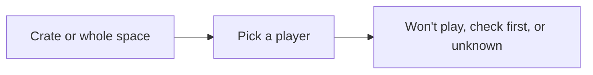

# Won't play

**Won't play** is under **Gig**. Pick a CDJ or XDJ, or **Common club players**. The list names tracks that player will refuse, with the reason and what to do. A file that could not be read stays **Unknown**. The check only reads headers.

Example data. A Friday crate has a 16-bit 44.1 kHz WAV and a WAV with a WAVE_FORMAT_EXTENSIBLE header. **Common club players** marks the first **Will play** and the second **Won't play**. The reason names the extensible header. Nothing is written.

**All tracks** checks the space. A crate checks that crate and its subcrates. **Show** filters the list. The default is **Won't play and check first**.

Common club players uses the stricter limit when the manuals disagree, and the page says which manual forced it. **Will play** means the header sits in that table. It does not mean a deck played the file.
